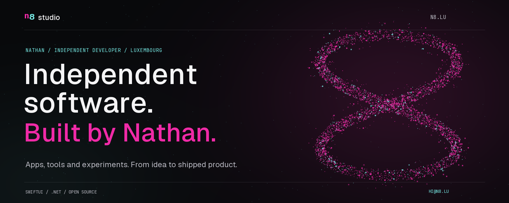

  

  Independent developer in Luxembourg. 
  I design, build and maintain apps, developer tools and the systems behind them.

  <a href="https://n8.lu/"><strong>Explore n8 studio ↗</strong></a> &nbsp; / &nbsp;
  <a href="https://github.com/nathan5580?tab=repositories">Browse the code</a> &nbsp; / &nbsp;
  <a href="mailto:hi@n8.lu">Get in touch</a>

---

## 01 / Selected work

### [Letz Park+ ↗](https://n8.lu/apps/luxembourg-live-parking/)

Parking and public transport in Luxembourg. Live spaces, forecasts, departures and CarPlay.

`SwiftUI` · `.NET` · `Orleans`

### [Quartz Supervisor ↗](https://github.com/nathan5580/QuartzSupervisor)

An embedded, read-only Quartz.NET dashboard for ASP.NET Core applications.

`C#` · `ASP.NET Core` · `Quartz.NET`

### [.NET Clean Architecture ↗](https://github.com/nathan5580/dotnet-clean-arch-template)

A .NET 10 starter with bounded contexts and architectural conventions enforced by tests.

`.NET 10` · `Blazor` · `Architecture`

### [Dot.Conductor ↗](https://www.nuget.org/packages/Dot.Conductor/)

A fluent Unit of Work and Repository library for Entity Framework Core, with multi-tenancy and temporal queries.

`C#` · `EF Core` · `NuGet`

[More apps, tools and experiments →](https://n8.lu/#work)

## 02 / How I build

**Useful first.** Real problems, focused products, interfaces that stay out of the way.  
**End to end.** From the first screen to the API, deployment and maintenance.  
**Open where it helps.** Libraries and templates that other developers can use.

## 03 / Working with

`SwiftUI` · `C#` · `.NET` · `Blazor` · `Orleans` · `Aspire` · `PostgreSQL` · `Cloudflare`

---

  <a href="https://n8.lu/">n8.lu</a> &nbsp;·&nbsp;
  <a href="https://status.n8.lu/">Service status</a> &nbsp;·&nbsp;
  <a href="mailto:hi@n8.lu">hi@n8.lu</a>

Built by Nathan. Maintained with care.

